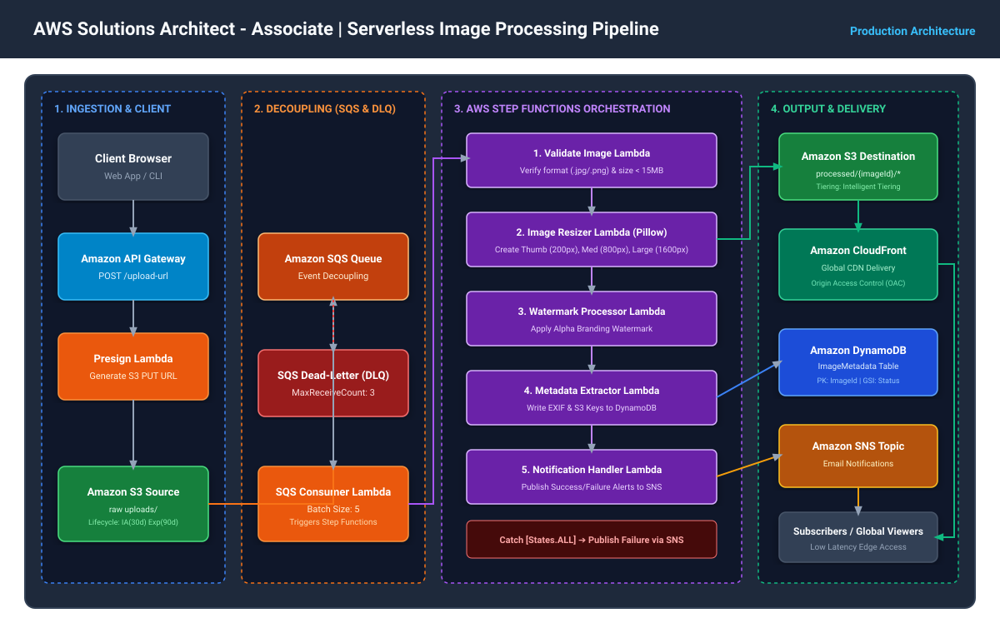
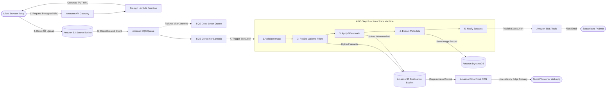

# AWS 2: Becoming a Solutions Architect

> **Graduation Project: Serverless Image Processing Pipeline**  
> **Course:** AWS 2: Becoming a Solutions Architect  
> **Author:** Graduation Project Candidate  
> **Architecture Pattern:** Serverless Event-Driven Architecture  
> **Instructor:** Ayman Aly Mahmoud  

[](https://aws.amazon.com/)
[](https://www.terraform.io/)
[](https://aws.amazon.com/cloudformation/)
[](https://aws.amazon.com/serverless/)
[](https://opensource.org/licenses/MIT)

---

## 📌 Table of Contents

- [Overview](#-overview)
- [Architecture Diagram](#-architecture-diagram)
- [Step-by-Step Architecture Flow](#-step-by-step-architecture-flow)
- [AWS Services Used & Justification](#-aws-services-used--justification)
- [Repository Structure](#-repository-structure)
- [Step Functions Workflow](#-step-functions-workflow)
- [Deployment Guide](#-deployment-guide)
  - [Prerequisites](#prerequisites)
  - [Deploy with Terraform (Recommended)](#deploy-with-terraform-recommended)
  - [Deploy with AWS CloudFormation](#deploy-with-aws-cloudformation)
- [Verification & Testing](#-verification--testing)
  - [Interactive Web Client](#1-interactive-web-client)
  - [Automated Python CLI Test](#2-automated-python-cli-test)
- [Well-Architected Framework Alignment](#-well-architected-framework-alignment)
- [Cost & Free Tier Optimization](#-cost--free-tier-optimization)
- [Security & Best Practices](#-security--best-practices)
- [Resource Teardown](#-resource-teardown)

---

## 📖 Overview

This repository contains the complete implementation and production-grade documentation for an **automated, event-driven, serverless image processing pipeline** built on Amazon Web Services (AWS).

Modern web and mobile applications require dynamic media transformation (creating thumbnails, multiple responsive resolutions, copyright watermarking, and metadata extraction) without burdening monolithic backends or leaving expensive virtual servers running 24/7.

This architecture leverages **Amazon S3, Amazon SQS, AWS Lambda, AWS Step Functions, Amazon DynamoDB, and Amazon CloudFront** to provide an enterprise-grade solution that:
* **Scales automatically** from zero to thousands of images in parallel.
* **Eliminates idle compute costs** (100% free-tier eligible for testing and demo).
* **Guarantees resilience and failure isolation** using an Amazon SQS buffer and Dead-Letter Queue (DLQ).
* **Protects origin storage** and speeds up global delivery via Amazon CloudFront Origin Access Control (OAC).

---

## 📐 Architecture Diagram



> 💡 **Editable Diagram File:** The complete source diagram is provided in `architecture/architecture-diagram.drawio`. You can open and edit it directly in [draw.io (diagrams.net)](https://app.diagrams.net/).



---

## 🔄 Step-by-Step Architecture Flow

1. **Pre-Signed Upload Request**: The client requests a secure upload URL from **Amazon API Gateway** (`POST /upload-url`). The `presign_handler` Lambda function returns a short-lived (5-minute expiration) pre-signed S3 PUT URL.
2. **Direct Browser-to-S3 Upload**: The client uploads the binary image directly to the **Amazon S3 Source Bucket** (`uploads/{imageId}.jpg`), bypassing application servers and avoiding API Gateway payload limits.
3. **Decoupled Event Ingestion**: S3 emits an `s3:ObjectCreated:*` event to **Amazon SQS**. SQS buffers incoming events, protecting downstream components from traffic spikes. Repeated failures are sent to an **SQS Dead-Letter Queue (DLQ)**.
4. **Workflow Invocation**: An `sqs_consumer` Lambda reads SQS batches and starts an **AWS Step Functions (Standard Workflow)** execution with a unique run ID.
5. **Multi-Step Orchestration**:
   - **Validation Step**: Validates MIME type, file format, and enforces a 15MB size ceiling.
   - **Resizing Step**: Downloads the original image and utilizes Python Pillow to generate 3 standardized resolutions (`thumbnail`, `medium`, and `large`), storing them in the private destination S3 bucket.
   - **Watermarking Step**: Generates an RGBA branding watermark layer overlayed onto the medium image and saves it to S3.
   - **Metadata Extraction Step**: Extracts dimensions, file sizes, and generates CloudFront URLs; records full audit metadata into **Amazon DynamoDB**.
   - **Notification Step**: Emits an **Amazon SNS** email notification containing the processing summary.
6. **Global Edge Delivery**: Processed images in the private destination bucket are served globally through **Amazon CloudFront** using **Origin Access Control (OAC)** with HTTP/3, TLS 1.3, and aggressive edge caching.

---

## 🛠️ AWS Services Used & Justification

| Service | Architectural Role | Justification & Best Practice |
|---|---|---|
| **Amazon S3** | Source & Destination Object Storage | Provides 99.999999999% (11 9's) durability. Lifecycle policies transition old raw uploads to Standard-IA after 30 days and expire them after 90 days. |
| **Amazon SQS + DLQ** | Decoupling & Ingestion Buffer | Prevents sudden traffic surges from throttling compute. DLQ captures poison pills without blocking subsequent processing. |
| **AWS Lambda** | Serverless Compute Engine | Event-driven compute with zero idle cost. Memory tuned from 256MB to 1024MB for optimal performance and cost. |
| **AWS Step Functions** | Workflow Orchestration | Provides visual state execution, automated exponential retries with jitter, and centralized error catching. |
| **Amazon DynamoDB** | Fast NoSQL Metadata Store | On-Demand (PAY_PER_REQUEST) capacity mode with single-digit millisecond latency. Global Secondary Index (`StatusIndex`) for query filtering. |
| **Amazon CloudFront** | Global Content Delivery Network (CDN) | Distributes processed images through 300+ edge locations worldwide. Secured with **Origin Access Control (OAC)** to prevent direct public access to S3. |
| **Amazon API Gateway** | Managed REST API Endpoint | Exposes the pre-signed URL generation endpoint with built-in request throttling (10 RPS, 20 burst). |
| **Amazon SNS** | Pub/Sub Notification Service | Sends instant operational notifications to administrators upon workflow completion or fatal failure. |
| **AWS IAM** | Identity & Access Management | Strictly enforces **Least Privilege Access** with distinct execution roles for each component. |

---

## 📁 Repository Structure

```
aws-serverless-image-pipeline/
├── README.md                              # Master Solution Documentation
├── architecture/
│   ├── architecture-diagram.svg           # High-resolution SVG vector diagram
│   ├── architecture-diagram.drawio        # Fully editable Draw.io XML source
│   └── architecture-spec.md               # Architectural Decisions (ADRs) & Well-Architected mapping
├── terraform/                             # Production Terraform Infrastructure as Code (IaC)
│   ├── main.tf                            # Provider & backend configuration
│   ├── variables.tf                       # Input variables & parameter defaults
│   ├── outputs.tf                         # Output parameters & endpoints
│   ├── s3.tf                              # S3 source/dest buckets, CORS, & lifecycle rules
│   ├── sqs.tf                             # SQS main queue & Dead-Letter Queue (DLQ)
│   ├── lambda.tf                          # Lambda functions, packaging & event mappings
│   ├── step_functions.tf                  # Step Functions State Machine definition
│   ├── dynamodb.tf                        # DynamoDB metadata table & GSI
│   ├── api_gateway.tf                     # REST API Gateway & CORS configurations
│   ├── cloudfront.tf                      # CloudFront distribution & Origin Access Control (OAC)
│   ├── sns.tf                             # SNS topic & email subscriptions
│   ├── iam.tf                             # Granular IAM roles and least-privilege policies
│   └── terraform.tfvars.example           # Example variable definitions
├── cloudformation/                        # Native AWS CloudFormation Template
│   ├── template.yaml                      # Single-stack CloudFormation template
│   └── parameters.json                    # Stack parameter inputs
├── src/                                   # Lambda Application Handlers
│   ├── presign_handler/app.py             # Generates S3 Pre-signed upload URLs
│   ├── sqs_consumer/app.py                # Consumes SQS messages & triggers Step Functions
│   ├── workflow_validator/app.py          # Step 1: Validates format & file size
│   ├── image_resizer/app.py               # Step 2: Generates thumbnail, medium & large
│   ├── watermark_processor/app.py         # Step 3: Adds branding watermark overlay
│   ├── metadata_extractor/app.py          # Step 4: Writes item records to DynamoDB
│   └── notification_handler/app.py        # Step 5: Publishes SNS completion/failure alerts
├── step_functions/
│   └── image_processing_workflow.asl.json # Amazon States Language (ASL) workflow definition
├── demo_client/                           # Testing & Demonstration Tools
│   ├── index.html                         # Interactive Web Client for live uploads & demo
│   ├── test_upload.py                     # Automated end-to-end Python test script
│   └── sample_images/
│       └── sample.jpg                     # Sample test image
└── docs/
    ├── DEPLOYMENT_GUIDE.md                # Comprehensive deployment walkthrough
    ├── VIDEO_DEMO_SCRIPT.md               # 3-5 minute demo presentation script (EN & AR)
    └── COST_ANALYSIS.md                   # Free-tier & production cost breakdown
```

---

## 🚀 Deployment Guide

### Prerequisites
* An active **AWS Account** with administrative access.
* **AWS CLI** installed and configured (`aws configure`).
* **Terraform v1.3+** installed (or use CloudFormation).

### Deploy with Terraform (Recommended)

1. **Clone the repository:**
   ```bash
   git clone https://github.com/<your-username>/aws-serverless-image-pipeline.git
   cd aws-serverless-image-pipeline/terraform
   ```

2. **Configure Variables:**
   ```bash
   cp terraform.tfvars.example terraform.tfvars
   ```
   *Edit `terraform.tfvars` and set your email for SNS notifications.*

3. **Initialize and Deploy:**
   ```bash
   terraform init
   terraform plan
   terraform apply -auto-approve
   ```

4. **Confirm SNS Email Subscription:**
   Check your email inbox and click **"Confirm subscription"** in the message received from AWS Notifications.

---

### Deploy with AWS CloudFormation

```bash
cd aws-serverless-image-pipeline/cloudformation

aws cloudformation create-stack \
  --stack-name serverless-image-pipeline \
  --template-body file://template.yaml \
  --parameters ParameterKey=NotificationEmail,ParameterValue=your-email@example.com \
  --capabilities CAPABILITY_NAMED_IAM \
  --region us-east-1
```

---

## 🧪 Verification & Testing

### 1. Interactive Web Client
1. Open [`demo_client/index.html`](demo_client/index.html) in your browser.
2. Enter the `api_gateway_upload_endpoint` from Terraform outputs.
3. (Optional) Enter the `cloudfront_domain_name`.
4. Select `demo_client/sample_images/sample.jpg` and click **"Upload & Trigger Pipeline"**.
5. Observe the live execution log as the pre-signed URL is generated and the file is uploaded.

### 2. Automated Python CLI Test
```bash
cd demo_client
python -m pip install requests boto3 pillow
python test_upload.py \
  --api-url "https://<api-id>.execute-api.us-east-1.amazonaws.com/prod/upload-url" \
  --table-name "serverless-image-pipeline-metadata" \
  --region us-east-1
```

**Expected Test Output:**
```
============================================================
🚀 Starting End-to-End Pipeline Verification
============================================================

[Step 1] Requesting pre-signed URL from: https://.../upload-url
✅ Success! Generated Key: uploads/d41d8cd98f00b204e9800998ecf8427e.jpg

[Step 2] Uploading binary bytes to S3 via Pre-Signed URL...
✅ Direct S3 upload completed successfully!

[Step 3] Waiting for Step Functions workflow to execute...
   Polling DynamoDB (Attempt 2/12)...
   Found DynamoDB record! Status: COMPLETED

🎉 SUCCESS: Step Functions processing finished successfully!
============================================================
✅ ALL TESTS PASSED: S3 ➔ SQS ➔ Step Functions ➔ DynamoDB ➔ CloudFront
============================================================
```

---

## 🏛️ Well-Architected Framework Alignment

| Pillar | Implementation in this Project |
|---|---|
| **Operational Excellence** | Infrastructure as Code (Terraform & CloudFormation), centralized CloudWatch logs, Step Functions visual execution graphs, and automated failure notifications. |
| **Security** | S3 Block Public Access 100% active; private destination S3 bucket accessible only via CloudFront Origin Access Control (OAC); IAM least privilege; pre-signed URLs expired in 300s. |
| **Reliability** | SQS decoupled architecture handles sudden bursts; SQS Dead-Letter Queue isolates poison-pill messages; Step Functions retries automatically with exponential backoff. |
| **Performance Efficiency** | Offloaded image transfers directly to S3 via pre-signed URLs; dynamic memory allocation for compute-heavy Lambdas; global CloudFront caching reduces edge latency. |
| **Cost Optimization** | Zero idle costs ($0.00 when not in use); S3 lifecycle policies transition raw uploads to Standard-IA (30d) and expire (90d); destination images use S3 Intelligent-Tiering. |
| **Sustainability** | Serverless compute scales down to zero idle instances, maximizing server utilization and reducing carbon footprint. |

---

## 💰 Cost & Free Tier Optimization

Under AWS Free Tier allowances, running this project for development, testing, and graduation grading incurs **$0.00 / month**:

* **AWS Lambda**: 1,000,000 free requests & 3.2M seconds of compute/month.
* **Amazon S3**: 5 GB of standard storage & 20,000 GET requests.
* **Amazon SQS**: 1,000,000 requests/month.
* **AWS Step Functions**: 4,000 free state transitions/month.
* **Amazon DynamoDB**: 25 GB storage & 25 write/read units free forever.
* **Amazon CloudFront**: 1 TB data transfer out/month free forever.

*(See [`docs/COST_ANALYSIS.md`](docs/COST_ANALYSIS.md) for production-scale cost estimates).*

---

## 🧹 Resource Teardown

To avoid incurring unexpected charges after grading:

```bash
cd terraform
terraform destroy -auto-approve
```

---

## 📄 License & Attribution

This project is licensed under the MIT License - see the [LICENSE](LICENSE) file for details.  
Submitted as the official Graduation Project for the **AWS Solutions Architect - Associate** certification pathway.
